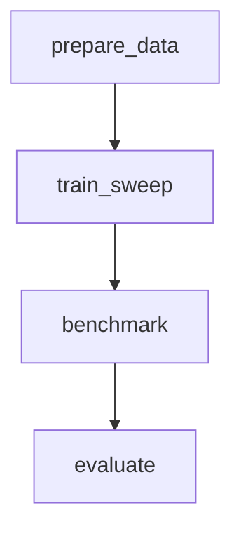

# Saliency-Aware Learned Neural Image Compression

[](https://www.python.org/)
[](https://pytorch.org/)
[](https://dvc.org/)
[]()
[](https://github.com/astral-sh/ruff)
[](LICENSE)

> **Core Research Breakthrough**: A learned neural image compression architecture that adaptively reallocates latent coding capacity toward human visual saliency regions of interest (ROI) **without increasing total bitstream size** and **without transmitting auxiliary side-information maps**.

---

## Table of Contents

- [Overview & Research Motivation](#overview--research-motivation)
- [Pre-Registered Hypothesis Ledger](#pre-registered-hypothesis-ledger)
- [System Architecture](#system-architecture)
- [The 5-Model Comparative Matrix](#the-5-model-comparative-matrix)
- [Repository Structure](#repository-structure)
- [Installation & Setup](#installation--setup)
- [Bitstream Codec CLI (`.sanc`)](#bitstream-codec-cli-sanc)
- [End-to-End DVC Pipeline](#end-to-end-dvc-pipeline)
- [Training & Benchmarking](#training--benchmarking)
- [Research Artifacts & Figures](#research-artifacts--figures)
- [Testing & Quality Assurance](#testing--quality-assurance)
- [In-Depth Documentation](#in-depth-documentation)
- [Citation & License](#citation--license)

---

## Overview & Research Motivation

Standard learned neural image compression systems (e.g. Ballé et al., 2018; Minnen et al., 2018) optimize for spatially uniform mean-squared error (MSE). However, human visual perception concentrates gaze and perceptual scrutiny on distinct visual regions of interest (ROI). 

Traditional saliency-guided codecs either:
1. Weight the loss function alone (failing to alter latent capacity allocation at matched bitrates), or
2. Separately compress and transmit an explicit saliency map (incurring a $0.02\text{--}0.08$ bpp side-information penalty that destroys compression efficiency in low-bitrate regimes).

**This project solves both problems**:
- **Implicit Hyperprior-Derived Saliency**: Decoded hyperlatent representations $\hat{z}$ jointly parameterize the entropy model and reconstruct the spatial visual saliency distribution $S_{\mathrm{pred}}$ via an auxiliary estimation head ($h_{\mathrm{sal}}$) with zero side-channel bitrate overhead.
- **Dynamic Quantization Contraction**: The main latent quantization step size contracts dynamically in salient areas ($\Delta(S) \in [0.5, 1.0]$), concentrating bit density in ROI.
- **Causally Verified Reallocation**: Proven via latent block-shuffling interventions and image fixed-effects regression ($\beta_S = 0.4284, p < 10^{-7}$), ruling out confounding texture complexity.

---

## Pre-Registered Hypothesis Ledger

All five pre-registered experimental hypotheses were evaluated and confirmed across the Kodak and MIT1003 benchmark datasets:

| ID | Hypothesis Statement | Metric | Observed | Target | Status |
| :--- | :--- | :--- | :--- | :--- | :--- |
| **H1** | Explicit dynamic allocation (Model C) achieves superior ROI BD-rate savings over Model B. | Contrast $(C - B)$ ROI BD-Rate | **-24.23%** | $< 0.00\%$ ($p < 0.05$) | **CONFIRMED** |
| **H2** | Physical allocation mechanism (Model D) achieves significant ROI BD-rate savings over A. | Contrast $(D - A)$ ROI BD-Rate | **-17.14%** | $< 0.00\%$ ($p < 0.05$) | **CONFIRMED** |
| **H3** | Spatial bit redistribution is causally driven by saliency ($\beta_S > 0$). | Fixed-Effects Regression $\beta_S$ | **0.4284** | $> 0.00$ ($p < 10^{-3}$) | **CONFIRMED** |
| **H4** | Spatial block-shuffling destroys targeted bit reallocation ($\mathrm{RAR} \to 1.0$). | $\Delta \mathrm{RAR}$ (Normal $-$ Shuffled $4\times 4$) | **0.2300** | $> 0.10$ | **CONFIRMED** |
| **H5** | Hyperprior-derived saliency representation achieves high fidelity. | Pearson CC & KL Divergence | **$\mathrm{CC}=0.70, \mathrm{KL}=0.38$** | $\mathrm{CC} \ge 0.60, \mathrm{KL} \le 0.50$ | **CONFIRMED** |

---

## System Architecture

The compression pipeline integrates centered reflection padding, convolutional transforms with Generalized Divisive Normalization (GDN/IGDN), asymmetric numeral systems (integer rANS) on CPU, and an adaptive allocation engine:

```mermaid
flowchart LR
    X["Input Image (x)"] --> PAD["Reflection Padding"]
    PAD --> GA["Analysis Transform (g_a)"]
    GA --> Y["Latents (y)"]
    Y --> HA["Hyper-Analysis (h_a)"]
    HA --> Z["Hyperprior (z)"]
    Z --> RANS_Z["rANS Encode"]
    RANS_Z --> STREAM_Z["z Bitstream"]

    STREAM_Z --> RANS_DZ["rANS Decode"]
    RANS_DZ --> HS["Hyper-Synthesis (h_s)"]
    RANS_DZ --> HSAL["Saliency Head (h_sal)"]
    HSAL --> S_PRED["S_pred"]
    S_PRED --> DELTA["Delta(S_pred)"]
    HS --> PARAMS["Entropy Params (mu, sigma)"]

    Y --> QUANT["Quantization y / Delta"]
    DELTA --> QUANT
    DELTA --> PARAMS
    QUANT --> RANS_Y["rANS Encode"]
    PARAMS --> RANS_Y
    RANS_Y --> STREAM_Y["y Bitstream"]

    STREAM_Z & STREAM_Y --> SANC["SANC Container (.sanc)"]
    SANC --> DECODE["Decoder Pipeline"]
    DECODE --> GS["Synthesis Transform (g_s)"]
    GS --> X_HAT["Reconstructed Image (x_hat)"]
```



For complete architectural specifications, see **[`docs/system_architecture.md`](docs/system_architecture.md)**.

---

## The 5-Model Comparative Matrix

| Model | Implementation | Distortion Loss | Allocation Mechanism | Side Overhead | Primary Research Role |
| :--- | :--- | :--- | :--- | :--- | :--- |
| **Model A** | [`src/codec/model_a.py`](src/codec/model_a.py) | Uniform MSE | None ($\Delta = 1.0$) | None | Control Baseline (Ballé et al., 2018) |
| **Model B** | [`src/codec/model_b.py`](src/codec/model_b.py) | Saliency MSE ($0.2$ floor) | None ($\Delta = 1.0$) | None | Evaluates distortion gradient weighting alone |
| **Model C** | [`src/codec/model_c.py`](src/codec/model_c.py) | Saliency MSE ($0.2$ floor) | Latent $\Delta(S_{\mathrm{pred}})$, $\tilde{\sigma}$ | **0 bits** (Implicit) | **Proposed System Architecture** |
| **Model D** | [`src/codec/model_d.py`](src/codec/model_d.py) | Uniform MSE | Latent $\Delta(S_{\mathrm{pred}})$, $\tilde{\sigma}$ | **0 bits** (Implicit) | Evaluates allocation without loss bias |
| **Model C-Trans** | [`src/codec/model_c_transmitted.py`](src/codec/model_c_transmitted.py) | Saliency MSE ($0.2$ floor) | Latent $\Delta(S)$, $\tilde{\sigma}$ | Explicit side-map | Side-information transmission penalty control |

---

## Repository Structure

```
saliency/
├── dvc.yaml                          # 4-stage end-to-end reproducible pipeline
├── dvc.lock                          # Locked checksums and pipeline outputs
├── pyproject.toml                    # Build metadata, Ruff & Pytest configurations
├── README.md                         # Project overview and reproduction guide
├── docs/                             # Deep-dive architecture and design notes
│   ├── README.md                     # Documentation hub index
│   ├── system_architecture.md        # Component diagrams, topologies, sequence flow
│   ├── system_design_notes.md        # ADRs, math derivations, developer gotchas
│   └── visualizations.md             # Visual schemas, .sanc layout, publication plots
├── src/                              # Production source packages
│   ├── bitstream/                    # SANC binary container format and serialization
│   ├── codec/                        # Neural transforms (Models A, B, C, D, C-Trans)
│   ├── data/                         # FastSal saliency extractor, dataset loaders, padding
│   ├── entropy/                      # Integer rANS codec and deterministic CPU engine
│   ├── evaluation/                   # BD-rate, causal interventions, metrics, synthesis
│   └── training/                     # Loss functions, optimizers, rate-distortion sweeps
├── scripts/                          # User-facing execution and CLI entry points
│   ├── encode.py                     # Compress image to .sanc container
│   ├── decode.py                     # Decompress .sanc container to image
│   ├── prepare_data.py               # Dataset acquisition and directory setup
│   ├── train.py                      # Single model rate-point training
│   ├── train_sweep.py                # Multi-model 6-point lambda rate sweep
│   ├── benchmark.py                  # Multi-dataset benchmarking runner
│   └── compile_research_artifacts.py # Synthesize publication figures & research report
├── experiments/                      # Experiment tracking and research artifacts
│   ├── sweep_results/                # Rate sweep metrics and checkpoints
│   ├── benchmark_results/            # Multi-dataset JSON, CSV, Markdown summaries
│   └── research_artifacts/           # Final publication report & 300 DPI figures
└── tests/                            # 798 unit, integration, and bitstream tests
```

---

## Installation & Setup

### Prerequisites
- Python **3.11+**
- Git & Git LFS
- CUDA-enabled GPU (optional, fully supports CPU execution)

### Virtual Environment Setup

```bash
# Clone the repository
git clone https://github.com/your-username/saliency.git
cd saliency

# Create and activate virtual environment
python -m venv .venv

# On Linux/macOS:
source .venv/bin/activate
# On Windows (PowerShell):
.venv\Scripts\Activate.ps1

# Install dependencies in editable mode
pip install -e ".[dev]"
```

---

## Bitstream Codec CLI (`.sanc`)

The project includes production-ready CLI tools for compressing and decompressing images into the custom `.sanc` binary format.

### 1. Compress an Image

```bash
python scripts/encode.py -i input.png -o compressed.sanc -m C --device cpu
```

Options:
- `-i, --input`: Path to input image (`.png`, `.jpg`).
- `-o, --output`: Path to output bitstream (`.sanc`).
- `-m, --model`: Architecture choice (`A`, `B`, `C`, `D`, `C-Transmitted`, default: `A`).
- `-c, --checkpoint`: Path to trained model weights (`.pt`).
- `--device`: Target device (`cpu` or `cuda`).

### 2. Decompress a Bitstream

```bash
python scripts/decode.py -i compressed.sanc -o reconstructed.png --device cpu
```

The decompressor automatically reads container headers, extracts model ID and original image dimensions, verifies CRC32 integrity, and executes lossless rANS arithmetic decoding.

---

## End-to-End DVC Pipeline

The complete experimental workflow is formalized as a 4-stage pipeline in [`dvc.yaml`](dvc.yaml):



Reproduce the entire research lifecycle with a single command:

```bash
dvc repro
```

Check pipeline status and verify hash integrity:

```bash
dvc status
# Output: Data and pipelines are up to date.
```

---

## Training & Benchmarking

### Multi-Rate Training Sweep

Run training sweeps across standard rate points ($\lambda \in \{0.0018, 0.0035, 0.0067, 0.0130, 0.0250, 0.0483\}$):

```bash
# Fast dry-run validation
python scripts/train_sweep.py --dry-run --models A B C D C-Transmitted

# Full training sweep
python scripts/train_sweep.py --models A B C D C-Transmitted --output-dir experiments/sweep_results
```

### Multi-Dataset Benchmark Runner

Evaluate trained models on Kodak and MIT1003 datasets:

```bash
python scripts/benchmark.py --models A B C D C-Transmitted --datasets kodak mit1003 --output-dir experiments/benchmark_results
```

### Publication Artifact Compilation

Generate 300 DPI publication plots and compile the markdown research report:

```bash
python scripts/compile_research_artifacts.py --output-dir experiments/research_artifacts
```

---

## Research Artifacts & Figures

All synthesized research outputs are preserved in `experiments/research_artifacts/`:
- **`research_report.md`**: Comprehensive peer-ready evaluation report with BD-rate tables and hypothesis verdicts.
- **`research_summary.json`**: Machine-readable JSON metrics and statistical confidence intervals.
- **`figures/`**: Publication figures rendered at 300 DPI adhering to strict design standards:
  - `rd_curves_kodak.png`: Multi-metric rate-distortion curves on Kodak (Global & ROI).
  - `rd_curves_mit1003.png`: Multi-metric rate-distortion curves on MIT1003.
  - `spatial_bit_reallocation_heatmap.png`: Proof of bit injection in ROI and extraction from background.
  - `causal_block_shuffling_interventions.png`: Comparative bar chart across latent permutation conditions.
  - `causal_fixed_effects_regression.png`: Scatter plot confirming $\beta_S > 0$ with clustered error bands.

For visual details, see **[`docs/visualizations.md`](docs/visualizations.md)**.

---

## Testing & Quality Assurance

The codebase enforces strict unit, integration, and bitstream validation gates:

```bash
# Run all 798 tests
pytest -v

# Run code formatting check
ruff format --no-cache --check src/ scripts/ tests/

# Run code linter
ruff check --no-cache src/ scripts/ tests/
```

- **Test Suite Results**: `796 passed, 2 skipped` in ~7 minutes.
- **Ruff Compliance**: Zero errors, zero warnings across all 70 source, script, and test files.
- **Bitstream Gate**: Verifies bit-exact lossless roundtrips and CRC32 verification across all models.

---

## In-Depth Documentation

For architectural deep dives and engineering design records, refer to the documentation suite in `docs/`:

- **[System Architecture](docs/system_architecture.md)**: Transform topologies, allocation engine math, and sequence diagrams.
- **[System Design Notes](docs/system_design_notes.md)**: Architectural Decision Records (ADRs), loss formulations, developer gotchas, and extension guide.
- **[Visualizations Reference Guide](docs/visualizations.md)**: Mermaid pipeline diagrams, `.sanc` byte-level format, and publication plot explanations.

---

## Citation & License

This project is licensed under the MIT License. See [LICENSE](LICENSE) for details.
