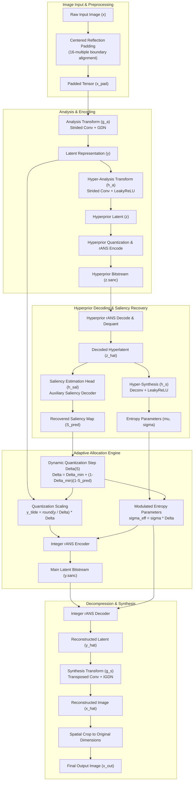
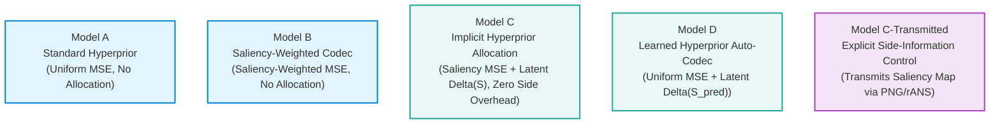
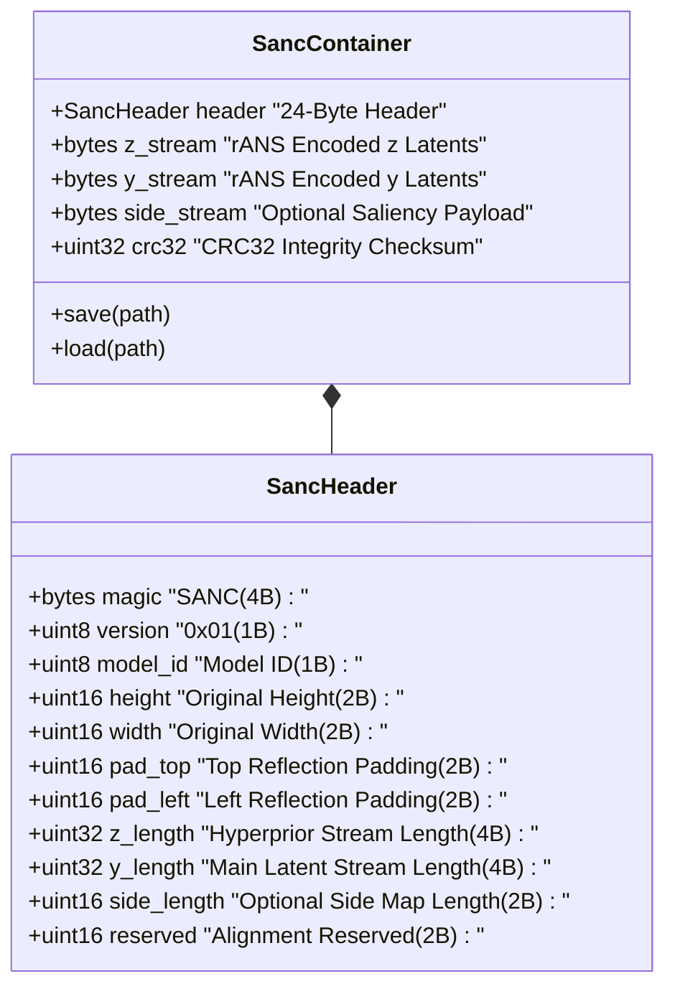
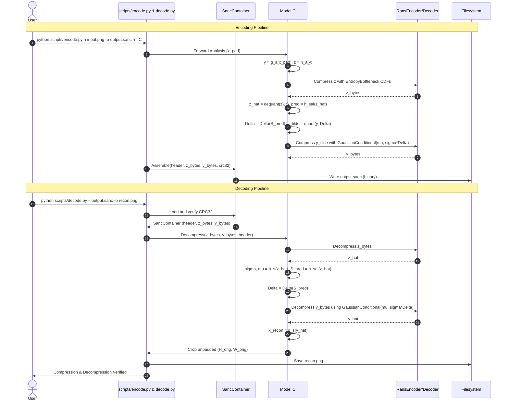

# System Architecture

This document describes the architectural design, component interactions, neural network topologies, and data representations of the **Saliency-Aware Learned Neural Image Compression** system.

---

## 1. High-Level Architectural Overview

The system extends variational autoencoder (VAE) image compression architectures (based on Ballé et al., 2018) with **adaptive spatial bit allocation** driven by visual saliency. The primary goal is to prioritize bitrate in high-salience Regions of Interest (ROI) while maintaining a matched or reduced total bitstream size without requiring auxiliary side-information transmission.

---

## 2. Model Comparative Matrix

The codebase defines five distinct model variants across the experimental matrix to rigorously isolate causal mechanisms and architectural components:

| Model | Identifier | Distortion Loss | Allocation Mechanism | Saliency Transmission | Primary Role |
| :--- | :--- | :--- | :--- | :--- | :--- |
| **Model A** | `src/codec/model_a.py` | Uniform MSE | None ($\Delta = 1.0$) | None | Control baseline (Ballé 2018) |
| **Model B** | `src/codec/model_b.py` | Saliency MSE ($0.2$ floor) | None ($\Delta = 1.0$) | None | Tests loss gradient weighting alone |
| **Model C** | `src/codec/model_c.py` | Saliency MSE ($0.2$ floor) | Latent $\Delta(S_{\mathrm{pred}})$, $\tilde{\sigma}$ | Hyperprior-Derived ($0$ side-bits) | Primary innovation under study |
| **Model D** | `src/codec/model_d.py` | Uniform MSE | Latent $\Delta(S_{\mathrm{pred}})$, $\tilde{\sigma}$ | Hyperprior-Derived ($0$ side-bits) | Tests allocation without loss bias |
| **Model C-Trans** | `src/codec/model_c_transmitted.py` | Saliency MSE ($0.2$ floor) | Latent $\Delta(S)$, $\tilde{\sigma}$ | Explicit side bitstream | Measures side transmission penalty |

---

## 3. Subsystem Breakdown

### 3.1 Neural Transforms (`src/codec/layers.py`, `src/codec/model_a.py`)

- **Analysis Transform ($g_a$)**: Maps input image $x \in \mathbb{R}^{3 \times H \times W}$ to latent representation $y \in \mathbb{R}^{C \times H/16 \times W/16}$ ($C=128$).
  - Four convolution stages (stride 2) paired with Generalized Divisive Normalization (**GDN**).
  - GDN non-linearities decorrelate local activations and enforce Gaussian marginals:
    $$y_i = \frac{x_i}{\left(\beta_i + \sum_j \gamma_{ij} x_j^2\right)^{1/2}}$$
- **Synthesis Transform ($g_s$)**: Reconstructs image $\hat{x}$ from latent $\hat{y}$ using four transposed convolution stages paired with Inverse GDN (**IGDN**).
- **Hyper-Analysis ($h_a$)**: Maps $|y|$ to hyperprior latent $z \in \mathbb{R}^{N \times H/64 \times W/64}$ ($N=192$) using convolutions and LeakyReLU activations.
- **Hyper-Synthesis ($h_s$)**: Decodes $\hat{z}$ to conditional scale/mean parameters $(\sigma, \mu)$ for the main latent distribution $p(y \mid \hat{z}) \sim \mathcal{N}(\mu, \sigma^2)$.

### 3.2 Adaptive Allocation Engine (`src/codec/allocation.py`)

The adaptive allocation engine modulates latent quantization step size based on local visual saliency $S_{\mathrm{pred}} \in [0, 1]$:

1. **Quantization Step Modulation**:
   $$\Delta(S) = \Delta_{\min} + (1.0 - \Delta_{\min})(1.0 - S)$$
   Where $\Delta_{\min} = 0.5$. In high-salience regions ($S \approx 1.0$), $\Delta \to 0.5$ (finer step size $\implies$ higher bit density). In background regions ($S \approx 0.0$), $\Delta \to 1.0$ (standard step size $\implies$ coarse quantization).
2. **Effective Scale Adjustment**:
   $$\tilde{\sigma}_{ij} = \sigma_{ij} \cdot \Delta_{ij}$$
   Because quantization step size contracts, the effective scale parameter for the Gaussian conditional CDF tables is adjusted to maintain accurate probability density evaluation.

### 3.3 Integer rANS Entropy Coding Core (`src/entropy/`)

- **Streaming rANS Engine (`src/entropy/coder.py`)**: Asymmetric Numeral Systems (ANS) encoder/decoder operating with exact 32-bit state registers and 16-bit cumulative probability frequencies.
- **CDF Monotonicity & Clamping (`src/codec/entropy_models.py`)**: Probability tables are clamped to non-zero probabilities $[1, 2^{16} - 1]$ to prevent zero-frequency division exceptions during arithmetic coding.
- **Deterministic CPU Execution Engine (`src/entropy/cpu_engine.py`)**: Latents are transferred to CPU for arithmetic encoding and decoding to ensure 100% deterministic, bit-exact reproducibility across different hardware platforms.

### 3.4 Binary Bitstream Container (`src/bitstream/container.py`)

All compressed streams are packaged in the custom `.sanc` format:

---

## 4. Sequence Diagram: Encoding & Decoding Flow

The sequence diagram below details the operational interaction across components during an image compression and decompression cycle:

