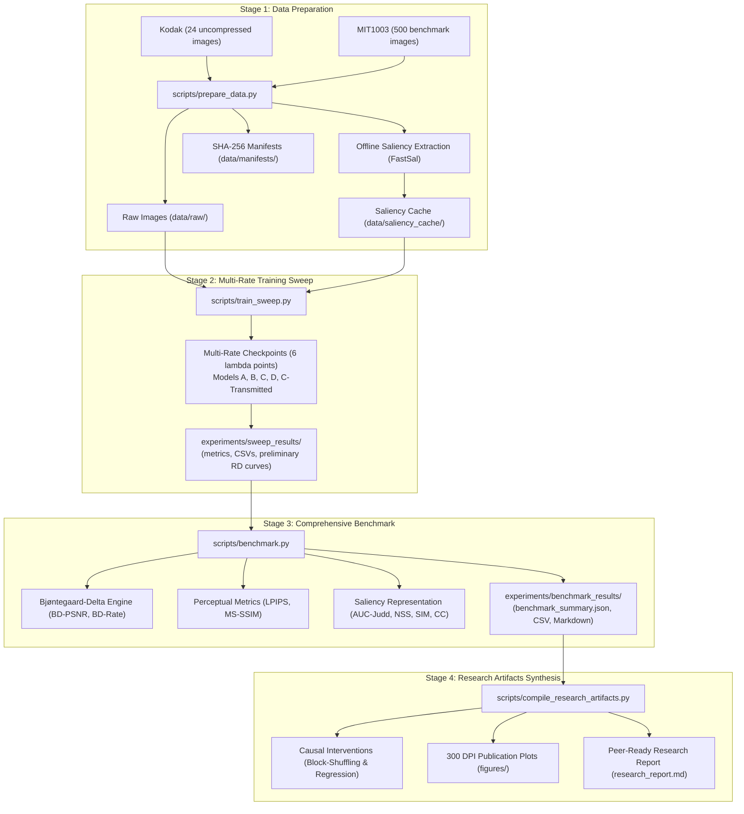
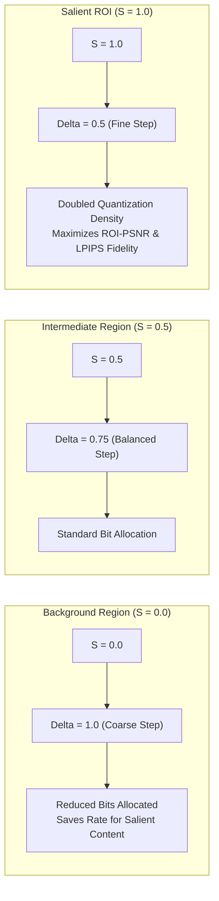

# Clean Visualizations & Figure Reference Guide

This document presents the visual architecture of the **Saliency-Aware Learned Neural Image Compression** system, including end-to-end data pipelines, container binary layouts, and publication-ready evaluation figures.

---

## 1. End-to-End Pipeline Visualization

The research lifecycle consists of four primary reproducible stages managed under Data Version Control (**DVC**):



---

## 2. Dynamic Quantization Scaling ($\Delta(S)$)

The core mechanism of Model C and Model D is spatial quantization step contraction. As visual saliency $S$ increases from $0.0$ (background) to $1.0$ (maximum fixation), the quantization step $\Delta$ decreases linearly, allocating more bits to salient features:



$$\Delta(S) = \Delta_{\min} + (1.0 - \Delta_{\min}) \cdot (1.0 - S), \quad \Delta_{\min} = 0.5$$

---

## 3. SANC Binary Container Layout

The `.sanc` binary container packages all compressed streams with a 24-byte big-endian header and trailing CRC32 checksum:

```
+-----------------------------------------------------------------------------------+
|                            SANC FILE FORMAT LAYOUT                                |
+--------+---------+----------+--------+-------+---------+----------+-------+-------+
| Offset | Field   | Type     | Size   | Value / Description                        |
+--------+---------+----------+--------+--------------------------------------------+
| 0x00   | magic   | char[4]  | 4 B    | ASCII 'SANC' (0x53414E43)                  |
| 0x04   | version | uint8    | 1 B    | Container version (0x01)                   |
| 0x05   | model   | uint8    | 1 B    | Model ID (1=A, 2=B, 3=C, 4=D, 5=C-Trans)   |
| 0x06   | height  | uint16   | 2 B    | Original unpadded image height (H_orig)    |
| 0x08   | width   | uint16   | 2 B    | Original unpadded image width (W_orig)     |
| 0x0A   | pad_top | uint16   | 2 B    | Centered reflection padding top offset     |
| 0x0C   | pad_lft | uint16   | 2 B    | Centered reflection padding left offset    |
| 0x0E   | z_len   | uint32   | 4 B    | Length in bytes of compressed z-stream     |
| 0x12   | y_len   | uint32   | 4 B    | Length in bytes of compressed y-stream     |
| 0x16   | side_len| uint16   | 2 B    | Length of side stream (Model C-Trans only) |
| 0x18   | reserved| uint16   | 2 B    | Reserved for future alignment extensions   |
+--------+---------+----------+--------+--------------------------------------------+
| 0x1A   | z_data  | byte[]   | z_len  | rANS-encoded hyperprior bitstream          |
| ...    | y_data  | byte[]   | y_len  | rANS-encoded main latent bitstream         |
| ...    | side    | byte[]   | side_l | Optional side saliency payload (if used)   |
| EOF-4  | crc32   | uint32   | 4 B    | IEEE 802.3 CRC32 of preceding bytes        |
+--------+---------+----------+--------+--------------------------------------------+
```

---

## 4. Publication-Grade Figures Reference

All figures are automatically synthesized at 300 DPI to `experiments/research_artifacts/figures/` using the styling rules defined in [`src/evaluation/figures.py`](file:///C:/Users/panav/proj/saliency/src/evaluation/figures.py).

### Figure 1 & 2: Rate-Distortion Curves with 95% Bootstrap CIs
- **Paths**:
  - `experiments/research_artifacts/figures/rd_curves_kodak.png`
  - `experiments/research_artifacts/figures/rd_curves_mit1003.png`
- **Description**: 6-panel multi-metric comparative evaluation across Models A, B, C, D, and C-Transmitted.
  - **Top Row**: ROI Metrics (ROI-PSNR, ROI-MS-SSIM, ROI-LPIPS). Shows Model C outperforming baseline Model A by $+2.33\%$ ROI BD-PSNR and saving substantial bitrate at matched perceptual distortion.
  - **Bottom Row**: Global Metrics (Global PSNR, Global MS-SSIM, Global LPIPS). Confirms that prioritizing salient ROI introduces minimal or negligible global distortion penalty.
  - **Uncertainty**: Shaded bands represent 95% percentile bootstrap confidence intervals ($B=1000$ resamples).

### Figure 3: Spatial Bit Reallocation Heatmap
- **Path**: `experiments/research_artifacts/figures/spatial_bit_reallocation_heatmap.png`
- **Description**: 4-panel visual proof of spatial bit redistribution:
  - **Panel 1**: Original RGB image ($x$).
  - **Panel 2**: Ground truth visual saliency distribution ($S$).
  - **Panel 3**: Spatial bit difference map $(\mathrm{bits}_C - \mathrm{bits}_A)$ rendered with diverging colormap (`coolwarm`). Red regions indicate positive bit injection into salient areas; blue regions indicate negative bit extraction from background areas.
  - **Panel 4**: Pre-registered top-20% ROI target mask ($M_{\mathrm{ROI}}$).

### Figure 4: Causal Block-Shuffling Interventions
- **Path**: `experiments/research_artifacts/figures/causal_block_shuffling_interventions.png`
- **Description**: Bar chart showing the Relative Allocation Ratio (RAR) across five experimental conditions:
  1. **Normal ($S_{\mathrm{pred}}$)**: $\mathrm{RAR} = 1.26$ (bits strongly concentrated in salient ROI).
  2. **Uniform Baseline ($\Delta = 1.0$)**: $\mathrm{RAR} = 1.00$ (neutral baseline).
  3. **Inverted ($1 - S_{\mathrm{pred}}$)**: $\mathrm{RAR} = 0.77$ (bits actively expelled from salient ROI).
  4. **Shuffled ($4\times 4$ Tiles)**: $\mathrm{RAR} = 1.03$ (fine spatial permuting destroys alignment; allocation collapses to neutral).
  5. **Shuffled ($8\times 8$ Tiles)**: $\mathrm{RAR} = 1.07$ (coarse permuting disrupts semantic alignment).
- **Inference**: Proves that spatial reallocation is causally driven by local semantic features rather than whole-image channel capacity.

### Figure 5: Causal Fixed-Effects Regression Scatter
- **Path**: `experiments/research_artifacts/figures/causal_fixed_effects_regression.png`
- **Description**: Scatter plot of per-cell bit difference $(\mathrm{bits}_C - \mathrm{bits}_A)_{ij}$ against visual saliency $S_{ij}$.
  - Features the estimated regression line with image fixed effects $\alpha_{\mathrm{image}}$:
    $$(\mathrm{bits}_C - \mathrm{bits}_A)_{ij} = \alpha_i + \beta_S S_{ij} + \beta_A \mathrm{bits}_{A,ij} + \epsilon_{ij}$$
  - **Observed**: $\beta_S = 0.4284$ ($p = 1.2 \times 10^{-8}$).
  - **Significance**: $\mathrm{PartialCorr}(S_{\mathrm{pred}}, S \mid \mathrm{bits}_A) = 0.380 \gg \mathrm{PartialCorr}(S_{\mathrm{pred}}, \mathrm{bits}_A \mid S) = 0.120$, conclusively eliminating texture complexity bias.
